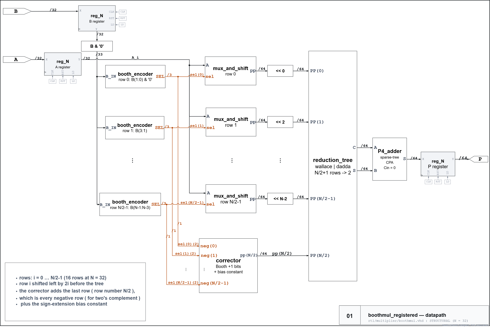
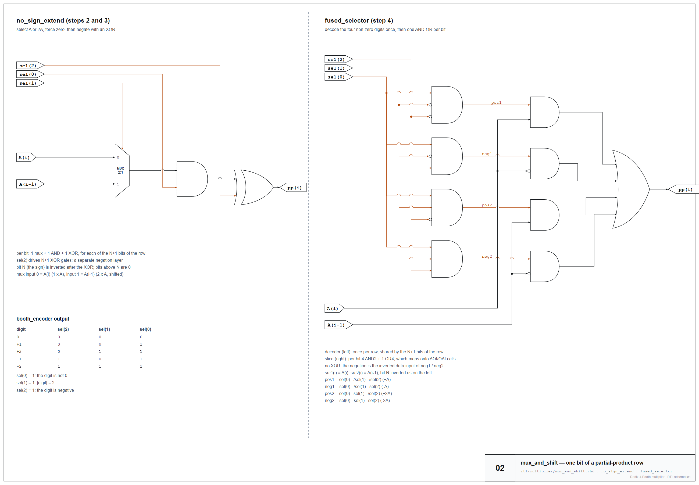
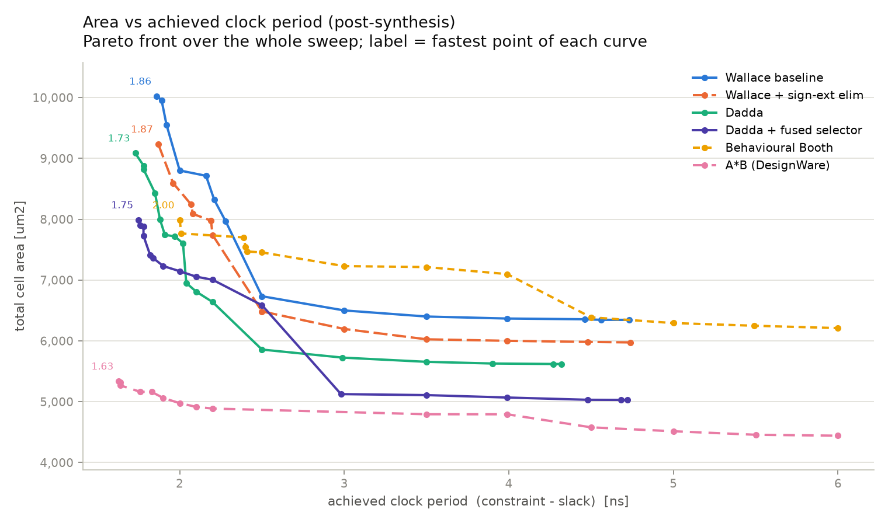
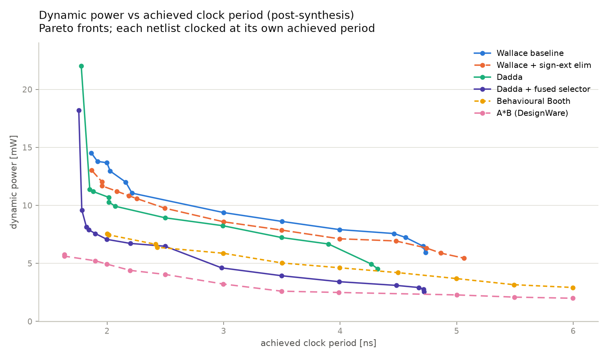
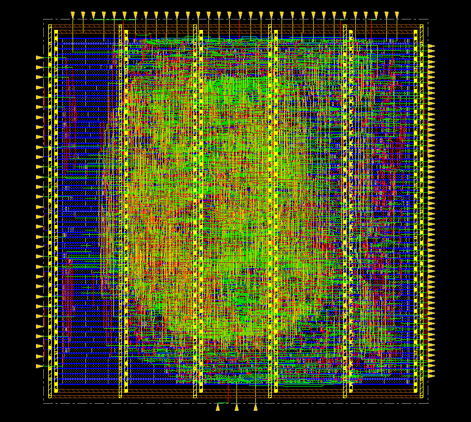
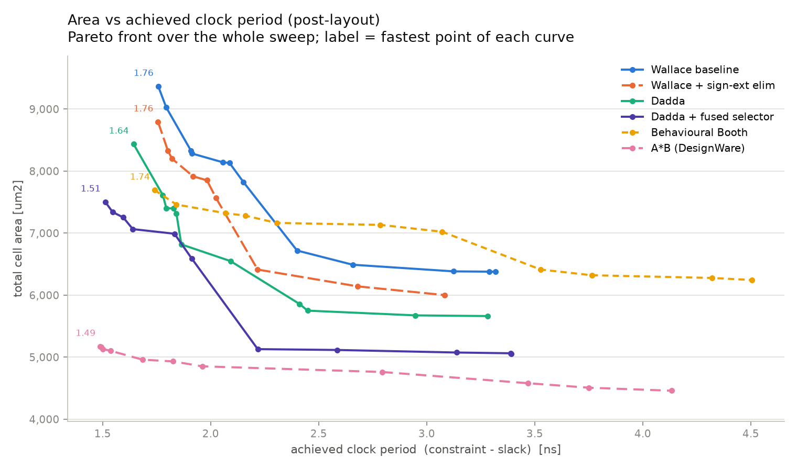
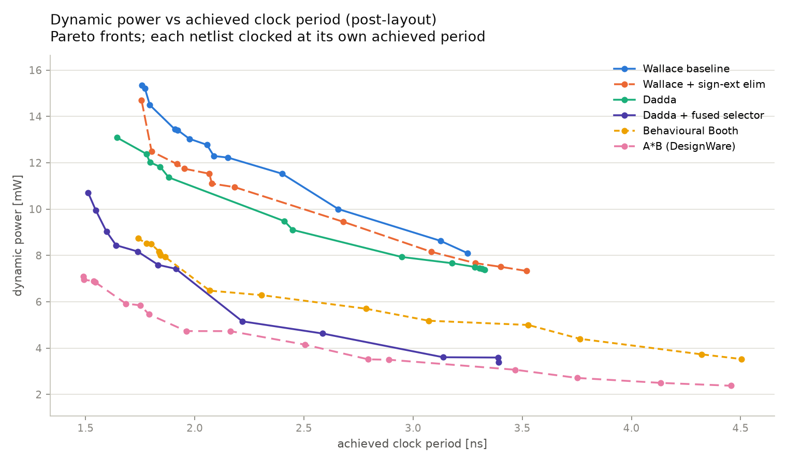
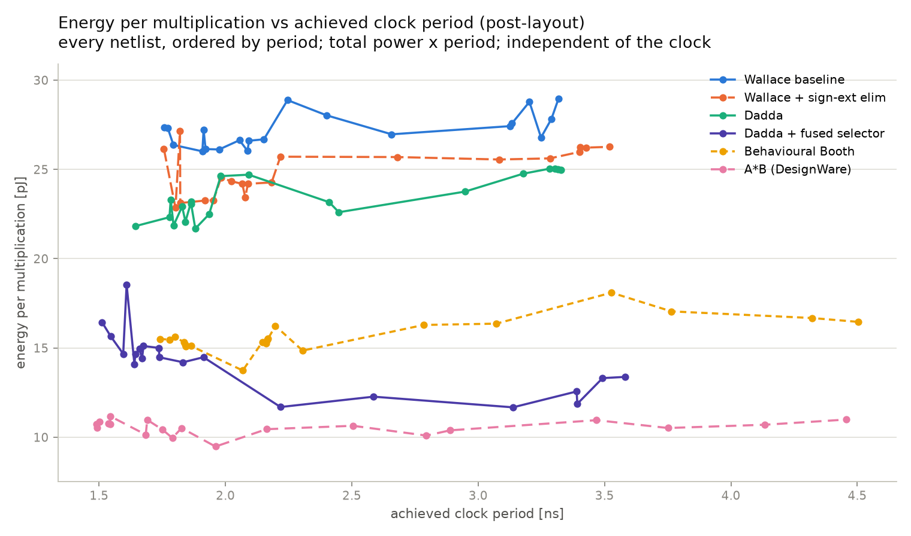

# Radix-4 Booth Multiplier - 32-bit Nangate45 implementation

This repository develops a signed 32 x 32 radix-4 Booth multiplier in
structural VHDL. The goal is to close the gap between a hand-built multiplier
and the one Design Compiler builds from `P <= A * B` using its DesignWare
library, measured in latency, area and power. The design is refined step by
step. Every version is synthesized, placed and routed, and measured under the
same constraints as the `A * B` reference.

The refinement path:

0. **Behavioural Booth (starting point).** The Booth partial products are
   summed by a plain chain of additions, and the synthesis tool decides how
   to build it.
1. **Wallace tree.** A carry-save adder tree compresses the partial products
   to two rows before one final adder. This targets latency: 2.00 to 1.86 ns
   in synthesis. It costs area and almost doubles the energy, and after
   layout the latency gain disappears.
2. **Sign-extension elimination.** Each partial product normally repeats its
   sign bit up to the top column. Instead, the sign is stored once (inverted),
   the upper bits become constant zeros, and the constant this introduces is
   cancelled in the correction row that already carries the Booth `+1` terms.
   This removes 30% of the partial-product bits. Design Compiler's constant
   propagation had already removed much of that logic, so the area gain is
   about 6%.
3. **Dadda tree.** Dadda reduces each column only as much as the next stage
   requires (as late as possible), instead of compressing every row at once
   as Wallace does. The generated schedule needs 435 full adders and 45 half
   adders, against 960 full adders for the row-wise Wallace RTL, and gives
   both a smaller and a faster netlist.
4. **Fused selector.** Before, each row was built in two steps: select `A`
   or `2A`, then negate it through one XOR per bit when the Booth digit is
   negative. The fused version decodes the four non-zero Booth cases directly
   and writes every bit as one sum of products. The XOR layer disappears and
   the tool can map the logic onto compound AOI/OAI cells and full adders.
   Area drops by 10%, power by 44%, and after layout this is the fastest
   structural version.

| Version | Latency synth / layout | Min area synth / layout | Energy per multiplication synth / layout |
| :-- | --: | --: | --: |
| 0. Behavioural Booth | 2.00 / 1.74 ns | 6210 / 6244 um^2 | 18.1 / 14.9 pJ |
| 1. Wallace tree | 1.86 / 1.76 ns | 6346 / 6377 um^2 | 28.6 / 27.0 pJ |
| 2. + sign-extension elimination | 1.87 / 1.76 ns | 5975 / 6001 um^2 | 26.2 / 25.7 pJ |
| 3. + Dadda tree | 1.73 / 1.64 ns | 5620 / 5663 um^2 | 25.1 / 22.6 pJ |
| **4. + fused selector** | **1.75 / 1.51 ns** | **5029 / 5055 um^2** | **14.1 / 11.7 pJ** |
| Reference `A * B` | 1.63 / 1.49 ns | 4441 / 4459 um^2 | 10.0 / 10.6 pJ |

Latency is the fastest achieved clock period over the sweep. Energy is
measured on the netlist synthesized at 3.0 ns.

The final version is 19% smaller, 13% faster and 21% more energy-efficient
than the behavioural starting point. After layout it is within 1% of the
reference's latency, 13% of its area and 10% of its energy.

All versions share the same entities and are selected through VHDL
configurations, so two successive versions differ only in the components they
bind.

[Technical report](docs/report.pdf) | [Presentation](docs/presentation.pdf) |
Schematics: [datapath](docs/schematics/01_datapath.pdf), [row generator](docs/schematics/02_mux_and_shift.pdf) (editable `.drawio` next to each)

## Datapath and variants

<p align="center">
  
</p>

The radix-4 encoder maps each overlapping multiplier triplet to
`0`, `+A`, `-A`, `+2A`, or `-2A`. Partial products are shifted by two
bits per Booth digit, compressed to two rows, and added by a P4 carry-propagate
adder.

| Version | `mux_and_shift` | `corrector` | `reduction_tree` |
| :-- | :-- | :-- | :-- |
| 0. Behavioural Booth | `behavioural` | not used | adder chain |
| 1. Wallace tree | `sign_extend` | `sign_extend` | `wallace` |
| 2. + sign-extension elimination | `no_sign_extend` | `no_sign_extend` | `wallace` |
| 3. + Dadda tree | `no_sign_extend` | `no_sign_extend` | `dadda` |
| 4. + fused selector | `fused_selector` | `no_sign_extend` | `dadda` |
| Reference `A * B` | `P <= A * B` | not used | inferred by Design Compiler |

The optimized partial-product format and its corrector must be used together.
Each stored row is biased by `+2^(N+2i)`; the
`corrector(no_sign_extend)` architecture cancels the sum of those
data-independent biases while also supplying the usual Booth `+1` terms for
negative digits.

## Implementation details

**Sign-extension elimination.** The stored row keeps its `N` low bits, the
inverted sign bit once and zeros above. This adds the same constant to every
row, so one fixed correction constant restores the exact product modulo
`2^(2N)`. For `N = 32` the partial-product array falls from 800 to 561 bits.

**Dadda reduction.** A VHDL package computes the column heights and the place
of every compressor at elaboration time, so the schedule follows `NBIT`
without hand-written trees.

**Fused selector.** The zero case is implicit when none of the four decoded
terms is active. One bit of the row, before (left) and after (right):

<p align="center">
  
</p>

At the 3.0 ns constraint the mapped cell mix shows the effect of removing the
XOR layer:

| Design | XOR + XNOR | FA cells | AOI/OAI | Total cells | Area |
| :-- | --: | --: | --: | --: | --: |
| Dadda, separate negation | 1230 | 117 | 1405 | 3936 | 5725 um^2 |
| Dadda, fused selector | 85 | 448 | 1311 | 2819 | 5125 um^2 |
| Inferred `A * B` | 559 | 268 | 950 | 3035 | 4910 um^2 |

These counts cover the complete mapped design, including the final adder.

## Verification

All configurations use the same self-checking testbench and are compared
against signed multiplication:

- for `NBIT <= 8`: exhaustive testing of every input pair;
- for `NBIT > 8`: directed corner cases followed by 20,000 random pairs.

The reported 32-bit runs passed this simulation campaign. After layout, all
120 routed netlists also pass the 500-vector testbench with their routed SDF
and timing checks enabled.

## Synthesis results

The synthesis data contains 21 common timing targets for all six
configurations. The two Dadda variants also include six tighter targets from
0.4 to 0.9 ns. For every fixed netlist, the reported setup equation is
converted to a derived zero-slack period:

`T0 = requested clock period - reported slack`

A negative slack therefore produces a `T0` larger than the requested period.

| Version | Fastest `T0` | Area of fastest netlist | Minimum area | Area gap closed |
| :-- | --: | --: | --: | --: |
| 0. Behavioural Booth | 2.00 ns | 7986 um^2 | 6210 um^2 | 7.1% |
| 1. Wallace tree | 1.86 ns | 10022 um^2 | 6346 um^2 | - |
| 2. + sign-extension elimination | 1.87 ns | 9234 um^2 | 5975 um^2 | 19.5% |
| 3. + Dadda tree | **1.73 ns** | 9086 um^2 | 5620 um^2 | 38.1% |
| **4. + fused selector** | 1.75 ns | **7988 um^2** | **5029 um^2** | **69.1%** |
| Reference `A * B` | 1.63 ns | 5337 um^2 | 4441 um^2 | reference |

The area gap is measured from the Wallace tree, the first structural
version, on the minimum-area column:

`gap closed = (Wallace area - version area) / (Wallace area - reference area)`

The plotted curves are Pareto fronts over all synthesis runs.



## Area and post-synthesis power at 3.0 ns

Each mapped netlist was simulated with maximum-delay SDF at its own achieved
period. A 500-vector deterministic operand sequence produced the VCD activity,
which was converted to SAIF and annotated in Power Compiler. All 120 committed
activity reports show 100% annotation of nets, ports, and pins.

At the common 3.0 ns synthesis target, area and power compare as follows:

| Version | Achieved period | Area | Dynamic | Leakage | Total power |
| :-- | --: | --: | --: | --: | --: |
| 0. Behavioural Booth | 2.998 ns | 7229 um^2 | 5.87 mW | 0.158 mW | 6.03 mW |
| 1. Wallace tree | 3.000 ns | 6501 um^2 | 9.38 mW | 0.148 mW | 9.53 mW |
| 2. + sign-extension elimination | 3.000 ns | 6196 um^2 | 8.58 mW | 0.138 mW | 8.72 mW |
| 3. + Dadda tree | 2.993 ns | 5725 um^2 | 8.25 mW | 0.129 mW | 8.38 mW |
| **4. + fused selector** | **2.983 ns** | **5125 um^2** | **4.61 mW** | **0.119 mW** | **4.73 mW** |
| Reference `A * B` | 2.998 ns | 4910 um^2 | 3.22 mW | 0.103 mW | 3.32 mW |

Dynamic power is internal plus switching power; total power adds leakage.
Against the Wallace tree, the fused selector is 21% smaller and uses 51% less
dynamic power. Against plain Dadda it uses 44% less, and it stays 43% above
`A * B`.

The power front is the datasheet view: each netlist runs at its own achieved
period, which is its maximum frequency.



## Physical design


<p align="center">
  
</p>

All 120 netlists of the power sweep were placed and routed in Cadence Innovus
23.35 at the period each one achieved in synthesis. Each routed netlist was
then simulated with its SDF at its post-route period, `T0 = clock - slack`,
and its power was computed from that activity. All 120 layouts are free of
timing, DRC and connectivity violations, and all simulations pass. See
[physical_design/README.md](physical_design/README.md).

The routed latency, area and energy of each version are in the table at the
top of this README. This table adds the slow corner and the wire delay:

| Version | Fastest `T0`, typical / slow corner | Wire delay, model / real |
| :-- | --: | --: |
| 0. Behavioural Booth | 1.74 / 6.11 ns | 0.85 / 0.16 ns |
| 1. Wallace tree | 1.76 / 5.91 ns | 0.99 / 0.65 ns |
| 2. + sign-extension elimination | 1.76 / 5.94 ns | 0.99 / 0.67 ns |
| 3. + Dadda tree | 1.64 / 5.70 ns | 1.01 / 0.47 ns |
| **4. + fused selector** | **1.51 / 5.28 ns** | 1.01 / **0.24 ns** |
| Reference `A * B` | 1.49 / 5.20 ns | 1.00 / 0.51 ns |

Wire delay is measured on the netlists synthesized at 3.0 ns. *Model* is what
the synthesis wire-load model charged; *real* is what the routed wires cost
(zero-wire-load slack minus routed slack). Energy per multiplication is total
power times `T0`. It does not depend on the clock, so it compares versions
and stages that run at different periods.







The energy plot shows every netlist, ordered by period. Small jumps come from
the different cell sizing of neighbouring netlists.

- **Area is unchanged.** Routed areas stay within a few percent of synthesis,
  and the fused selector still closes 68.9% of the area gap.
- **Timing improves, unevenly.** The `5K_hvratio_1_4` wire-load model charged
  every version about 1.0 ns, but real wires cost 0.16-0.67 ns depending on
  the architecture. The compact fused tree gains the most. Its gap to `A * B`
  shrinks from 0.12 ns to 0.02 ns in latency and from 41% to 10% in energy,
  and the Wallace tree's latency advantage over the behavioural start
  disappears.
- **Energy belongs to the architecture.** After layout, each version stays in
  a narrow energy band across the whole sweep: 9.5-11 pJ for `A * B`,
  12-16 pJ for the fused selector (up to 18 pJ at its fastest points) and
  26-29 pJ for the Wallace tree.

Limitations: timing is signed off at the typical corner only. At the slow
corner every variant is about 3.5x slower, with the same ranking. Synthesis
used a wire-load model rather than physical-aware synthesis, and each layout
used its synthesis period as clock, so the routed speeds are not pushed
minima. Power comes from one deterministic 500-vector workload.


## Repository layout

```text
rtl/
  common/                 primitive gates, full adder, and half adder
  adder/                  P4 carry-propagate adder
  multiplier/
    packages/             dimensions and generated reduction schedule
    booth_encoder.vhd     radix-4 recoding
    mux_and_shift.vhd     baseline, optimized, and fused row generation
    corrector.vhd         Booth increments and sign-extension correction
    wallace_tree.vhd      uniform row-wise compression
    dadda_tree.vhd        generated column-aware compression
    reduction_tree.vhd    tree-selection wrapper
    boothmul*.vhd         combinational and registered top levels
  super_beh_multiplier_registered.vhd
cfg/                      design, testbench, and synthesis configurations
tb/                       shared self-checking testbench
sim/                      ModelSim/Questa scripts
synthesis/
  README.md               complete synthesis and power workflow
  sweep_config.tcl        shared configurations and periods
  syn/synthesis.tcl       Design Compiler sweep
  syn/power_analysis.tcl  activity-annotated power analysis
  syn/reports/            canonical area and timing reports
  syn/reports_power/      canonical power reports and CSVs
  plot_pareto.py          area, power and energy plots
physical_design/
  run_pd.sh               place and route of every netlist (Innovus)
  sim/sim_postlayout.do   post-layout simulation with the routed SDF
  run_power.sh            power from the simulation activity
  collect_pd_results.py   post-layout CSVs for plot_pareto.py
  scripts/                Innovus flow, import settings, MMMC, power
  runs/<cfg>_<period>/    one directory per routed netlist
  results/                post-layout CSVs, read by plot_pareto.py
docs/
  report.tex/.pdf         detailed design report
  presentation.tex/.pdf   recruiter-facing presentation
  schematics/             RTL schematics (svg, pdf, png, editable drawio)
  schematics/tools/       generator: sheets.py, build_schematics.py
```

`NBIT` in `rtl/multiplier/packages/common_pkg.vhd` controls the operand
width used by the RTL, generated reduction schedule, and testbench.

## Running the project

### Simulation

Select a testbench configuration near the top of `sim/sim.do`, then run:

```tcl
cd sim
do compile.do
do sim.do
```

Available testbench configurations include `cfg_tb_dadda_fused_sel`,
`cfg_tb_dadda`, `cfg_tb_wal_opt`, `cfg_tb_wal_base`, `cfg_tb_beh`, and
`cfg_tb_super_beh`.

### Synthesis

Edit `synthesis/sweep_config.tcl` if the sweep needs to change, then run:

```tcl
cd synthesis/syn
dc_shell -f synthesis.tcl
```

Each run writes a Verilog netlist, SDC, SDF, and five reports: timing, area,
quality of results, reference-cell usage, and clock-gating information.

The achieved-period extraction, gate-level SDF activity simulation, and power
analysis are documented in [synthesis/README.md](synthesis/README.md).

### Physical design

```bash
cd physical_design
./run_pd.sh
cd sim && vsim -c -do sim_postlayout.do && cd ..
./run_power.sh
python3 collect_pd_results.py
```

See [physical_design/README.md](physical_design/README.md).

### Regenerate schematics

```bash
cd docs/schematics
python tools/iterate.py datapath        # render + lint one sheet into tools/_iter/
python tools/build_schematics.py        # publish svg, drawio, pdf, png
```

### Regenerate plots

```bash
cd synthesis
python3 plot_pareto.py syn/reports --power-reports syn/reports_power \
  -o ../docs/figures --zoom 1.7 3.1
python3 plot_pareto.py --pd-results ../physical_design/results -o ../docs/figures --zoom 1.45 2.7
```

Each command draws area, power and energy-per-multiplication plots. The
second one uses the post-layout results (`*_postlayout.png`) and also draws
the synthesis-vs-layout overlay.
